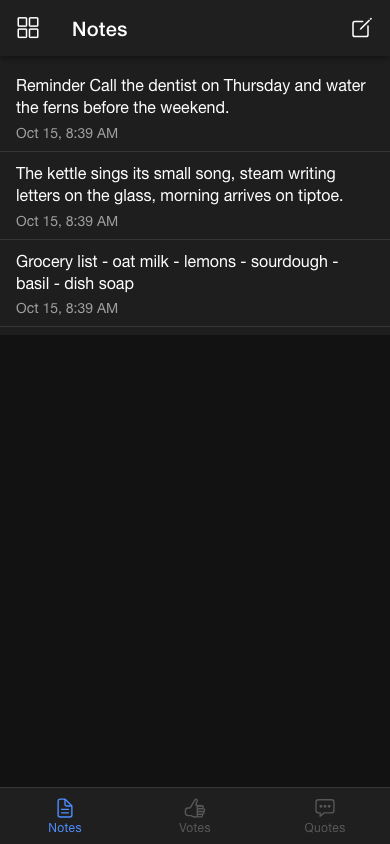
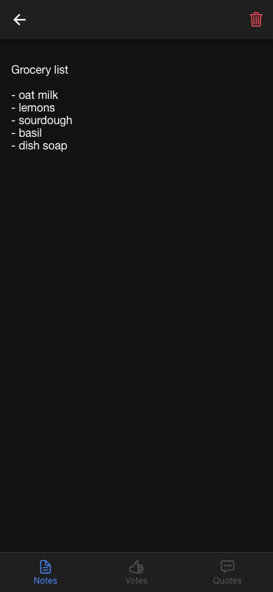
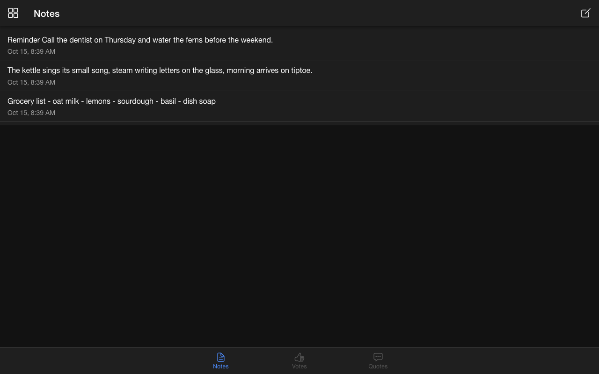

# Sticky Quotes

A notepad that is working towards something. Ionic Angular app with three tabs: Notes, Votes, Quotes. Version 1 is the Notes tab, title-less notes with full create, edit and delete, each note stored as one markdown file on disk by a tiny Node server. Votes and Quotes are placeholders for the next two stages.

Built as a personal tool, then opened up. No accounts, no database, no cloud. Your notes are files you own.

## Stack

- Angular 20, Ionic 8, Capacitor 8, TypeScript 5.9
- NgModules rather than standalone components, SCSS, dark mode always on
- A single-file Node HTTP server with zero npm dependencies for storage and static serving

## Run it

```bash
npm ci
node server/notes-api.js    # file API and static server on http://127.0.0.1:4310
npm start                   # Angular dev server on http://localhost:4300, proxies /api to :4310
```

For a single-process setup, `npm run build` and then `node server/notes-api.js` serves the built `www/` and the API together on port 4310.

Other scripts: `npm run build`, `npm test` (Karma and Jasmine), `npm run lint` (ESLint).

## Screenshots

Captured against a throwaway data dir holding three invented notes.

 

The notes list on a phone, newest first, and a note open in the editor.



The same list at desktop width.

## Where notes live

By default in `./data/` (gitignored), one markdown file per note with `createdAt` and `editedAt` frontmatter and the body below. All storage access in the app goes through the `NotesRepository` abstract class in `src/app/services/notes-repository.ts`; `HttpNotesRepository` is the only implementation.

## Configuration

Everything is optional. The defaults keep a fresh clone self-contained.

| Variable | Default | Purpose |
|---|---|---|
| `STICKY_QUOTES_PORT` | `4310` | Listen port |
| `STICKY_QUOTES_HOST` | `127.0.0.1` | Bind address. Keep it local and put a reverse proxy or Tailscale in front for phones |
| `STICKY_QUOTES_DATA_DIR` | `<repo>/data` | Directory for the note files |
| `STICKY_QUOTES_COMMIT_REPO` | unset | A git repo that contains the data dir. When set, each save is committed there, limited to the data dir, under a separate automation identity. Unset means nothing is committed |
| `STICKY_QUOTES_CORS_ORIGIN` | unset | Allowed origin for cross-origin callers. Unset means same-origin only |

## Phone access

The server listens on localhost on purpose. To use the app from a phone, front it with something that terminates TLS and does the auth, for example `tailscale serve --https=4310 http://127.0.0.1:4310`, then open the HTTPS URL on the phone and add it to the home screen. The dev server accepts other hosts with `ng serve --allowed-hosts <your-host>`.

## Server

`server/notes-api.js`. Routes: `GET` and `POST /api/notes`, `GET`, `PUT` and `DELETE /api/notes/:id`. Everything else serves `www/` with an SPA fallback, or a 503 until `www/` is built. Note ids are timestamps plus a short random suffix and are validated before touching the filesystem. Writes go to a temp file and are renamed into place.

## Layout

```
src/app/
  app.module.ts, app-routing.module.ts   '' redirects to /tabs
  models/note.model.ts                   Note = id, body, createdAt, editedAt (no title, by design)
  services/                              NotesRepository (abstract) and HttpNotesRepository
  tabs/                                  ion-tabs shell, tab bar, child routes
  pages/notes/                           list and note-editor (create, edit, delete)
  pages/votes/, pages/quotes/            placeholders, disabled tabs
server/notes-api.js                      the file API
.githooks/pre-commit                     hygiene gate, a no-op unless the maintainer's kit is present
```

## License

MIT
